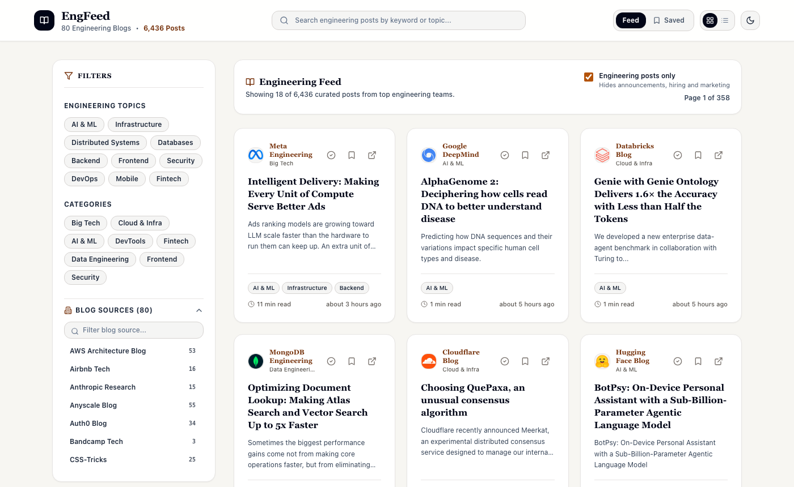
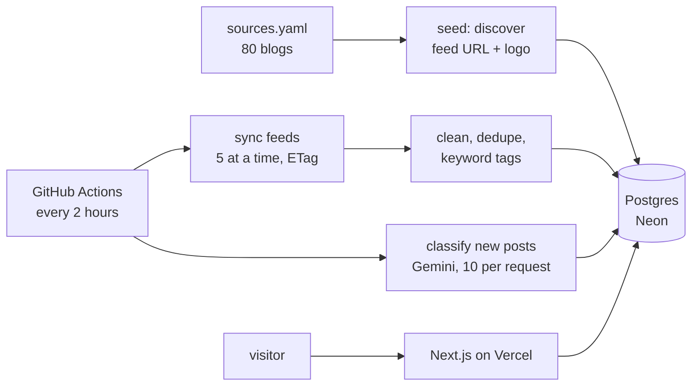

# EngFeed

A reader for 80 company engineering blogs that shows the engineering posts and hides the product announcements, hiring posts and marketing that make up most of what those blogs publish.

**Live: https://engfeed.vercel.app** · [](https://github.com/DecodeDebangi/engfeed/actions/workflows/test.yml)



Company blogs mix deep technical write-ups with launch notes and customer stories. EngFeed polls every blog in a curated list, and an LLM labels each post as engineering, announcement, careers or marketing, so the feed can show only the engineering ones. One tick box brings the rest back, and search and saved posts always show everything. The filtered feed is also available as RSS, for the whole feed or one topic.

> Status: running in production. Feeds sync every 2 hours through GitHub Actions; about two thirds of the 11,500 stored articles had been classified on 2026-11-12, and the rest are being worked through at up to 1,000 per run.

## How it works



- **Curated list:** blogs live in [`sources.yaml`](sources.yaml) with a name, website and category. The feed URL and logo are discovered from the site (its `<link rel="alternate">` tags, then common feed paths), so 51 of the 80 blogs need no feed URL at all. The other 29 pin one, usually because discovery would pick the whole company blog instead of its engineering section. Removing a blog retires it: polling stops and its articles stay.
- **Sync:** every feed is polled with `ETag`/`Last-Modified`, so unchanged feeds cost one small request. Posts are cleaned with `sanitize-html`, de-duplicated by a hash of their id, and given keyword topic tags that match whole words only.
- **Feed health:** a failed poll marks the feed `FAILING`, and 5 failures in a row mark it `BROKEN` (the local worker also retries each poll first). A broken feed whose URL was discovered is re-discovered automatically; a pinned one gets a suggested replacement in `npm run feeds:health`. The scheduled job also opens a GitHub issue (label `broken-feed`) when a feed breaks, and closes it when the feed recovers or the blog is retired.
- **Classifier:** new posts go to an LLM in batches of 10 with their title, blog and first 800 characters. It returns one of four kinds and topic tags from a fixed list; anything else in the answer is discarded. A rate limit or outage pauses the run without penalising articles, and a post whose answers keep failing is skipped after 3 tries. It works with any OpenAI-compatible API, and without one the feed still works, unfiltered.
- **RSS:** [`/feed.xml`](https://engfeed.vercel.app/feed.xml) has the latest 50 engineering posts, and `/feed/<topic>.xml` the same for one topic, such as [`/feed/databases.xml`](https://engfeed.vercel.app/feed/databases.xml). Items link to the original posts, and Vercel's CDN caches each feed for 30 minutes so readers polling it don't wake the database.
- **Site:** a Next.js app on Vercel reading Postgres on Neon. Bookmarks and read marks are kept per browser with a random, httpOnly cookie, so visitors don't share them. A Redis cache is supported but optional, and the live site runs without one.

## Results

| What | Measured |
|---|---|
| Blogs followed | 80, of which 51 need no feed URL |
| Articles stored | about 11,500 (2026-11-12) |
| Full sync of all 80 feeds | 28 s, 0 failures (5 feeds at a time) |
| Live API response, from India | about 0.45 s, of which about 0.2 s is the network |
| Classifier, exact label | 97/110 (34/40 on a sample untouched during tuning) |
| Engineering posts wrongly hidden | 6/36, all on posts whose label was debatable |
| Posts shown as engineering that weren't | 5/35 |
| Scheduled runs since launch | 16/16 succeeded |

The classifier was scored with `npm run eval:classify` on 110 real articles from the feed, using `gemini-3.1-flash-lite`. The labels were written by Claude, the AI assistant used to build this, before seeing any model output, not by an independent reviewer. 22 labels were marked debatable in advance, for example a post that announces a feature but explains how it works. On the same 110 articles a local `qwen2.5:7b` got 75 right, and a smaller 3B model managed at best 41 of the 70 it was tried on, which is why the classifier runs on a hosted free tier instead.

Two ideas to hide fewer good posts were tested on the same 110 articles and not shipped ([branch `experiment/full-text-classifier`](https://github.com/DecodeDebangi/engfeed/tree/experiment/full-text-classifier)). Asking the model whether it was sure, and hiding only confident labels, changed nothing: it said it was sure about all 110. Classifying from the fetched article page instead of the feed excerpt rescued 2 engineering posts but let 7 more announcements and marketing posts through.

Before the LLM, topic tags came from substring matching, which tagged 57% of posts "AI & ML" because "ai" matches "maintain" and "detail". Matching whole words brought that to 22%.

### Limits

- About 1 in 6 engineering posts is still hidden by the filter, mostly borderline ones. The tick box and search are the way to find them.
- Many feeds publish only an excerpt, so both the classifier and the reader see the first few hundred characters, not the whole post.
- GitHub runs scheduled workflows late: the 2-hour schedule has run about every 8 hours in practice.
- Gemini's free tier allows 500 requests a day per model, so a large backlog takes several days.
- Bookmarks belong to the browser, not an account; clearing cookies loses them.

## Run it

Needs Node.js 18.18 or later and Docker.

```bash
git clone https://github.com/DecodeDebangi/engfeed.git
cd engfeed
npm install
cp .env.example .env            # set ADMIN_API_KEY with: openssl rand -hex 32
docker compose up -d            # Postgres and Redis
npx prisma db push
npm run db:seed                 # loads sources.yaml and discovers feeds
npm run test:rss                # first sync of every feed
npm run dev                     # http://localhost:3000
```

To classify posts, set the `LLM_*` variables in `.env` (see [`.env.example`](.env.example)) and run `npm run classify`, or `npm run worker` to sync and classify on a schedule.

Useful commands:

```bash
npm run feeds:health                  # failing, broken and stale feeds
npm run feeds:discover -- <website>   # which feed and logo a website resolves to
npm run sync:scheduled                # one sync-and-classify pass, as GitHub Actions runs it
npm run eval:classify                 # score the configured LLM against the labelled articles
```

## Deploy

The live site uses Vercel and Neon on their free plans, with GitHub Actions doing the work a background worker would do elsewhere ([`sync-feeds.yml`](.github/workflows/sync-feeds.yml)).

1. **Neon:** create a project and copy its pooled and direct connection strings. Add `pgbouncer=true` to the pooled one.
2. **Schema and data:** with `DATABASE_URL` and `DIRECT_URL` pointing at Neon, run `npx prisma db push`, then `npm run db:seed` for an empty start or `pg_restore` a dump of a local database.
3. **Vercel:** import the repo and set `DATABASE_URL`, `DIRECT_URL` and `ADMIN_API_KEY`. Leave `NEXT_PUBLIC_ENABLE_ADMIN_SYNC` unset so the sync button stays hidden, and `REDIS_URL` unset unless you add a Redis cache such as Upstash.
4. **GitHub Actions secrets:** `DATABASE_URL`, `DIRECT_URL`, `LLM_MODEL`, `LLM_BASE_URL` and `LLM_API_KEY`.

Pushing to `main` deploys the site, and a change to `sources.yaml` applies itself to the database ([`seed-sources.yml`](.github/workflows/seed-sources.yml)). Schema changes are applied by hand with `npx prisma db push`. GitHub pauses scheduled workflows on public repos after 60 days without activity.

## API

| Route | Does |
|---|---|
| `GET /api/articles` | Paginated feed. Query: `page`, `limit`, `company`, `tag`, `search`, `sort`, `bookmarked`, and `kinds=all` to include non-engineering posts. |
| `GET /api/articles/[id]` | One article with its cleaned HTML, for the reader. |
| `GET /api/companies` | The followed blogs, with article counts. |
| `GET /api/stats` | Totals for the header. |
| `GET /feed.xml`, `GET /feed/<topic>.xml` | RSS 2.0 feeds of the latest engineering posts, overall or for one topic (`ai-ml`, `databases`, `distributed-systems` and so on). |
| `GET`/`POST /api/bookmarks` | The visitor's saved posts; `POST { "articleId": "..." }` toggles one. |
| `POST /api/read` | Mark a post read or unread. |
| `POST /api/admin/trigger-sync` | Sync now. Requires `Authorization: Bearer <ADMIN_API_KEY>`; refused when the key isn't set. |

## Tests

`npm test` runs all five suites, and GitHub Actions runs them, plus a type check and a production build, on every push to `main` and every pull request ([`test.yml`](.github/workflows/test.yml)), against fresh Postgres and Redis containers.

```bash
npm run test:tags       # keyword tagging rules
npm run test:sync       # feed sync, health states, discovery and retries, against real Postgres and Redis
npm run test:classify   # classifier error handling: rate limits, outages, bad answers
npm run test:alerts     # broken-feed issues opening, de-duplicating and closing
npm run test:api        # API routes, filters, per-visitor bookmarks, admin key and RSS feeds
```

The suites create temporary records and remove them afterwards, so they never touch real articles; `test:sync` and `test:classify` use a local stand-in server instead of real feeds or a real LLM, and `test:alerts` a stand-in for the GitHub API.
